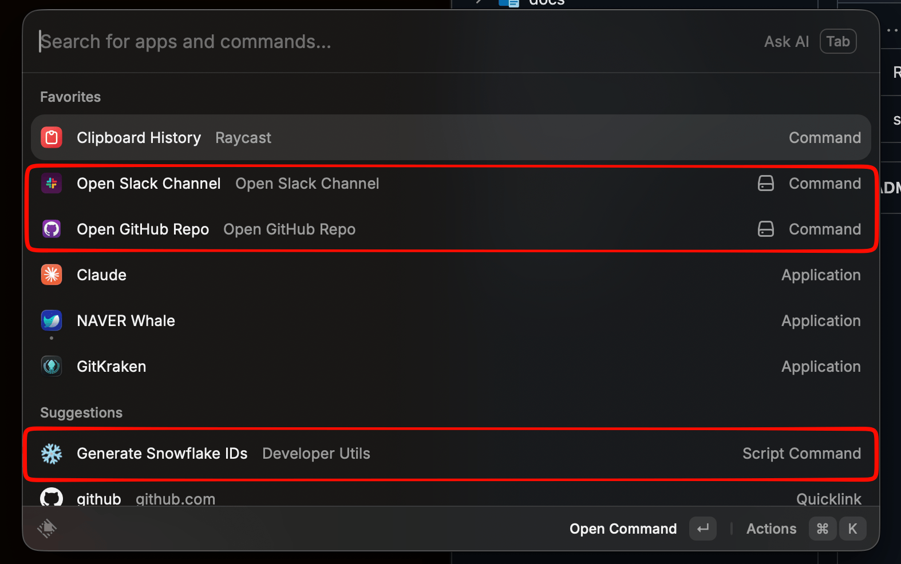

# Raycast Extensions

> [한국어](./README.md)

A collection of custom Raycast extensions for daily productivity.



| Extension | Type | Description |
|-----------|------|-------------|
| [Slack Channel Opener](./slack-channel-opener) | Extension | Search and open Slack channels by name |
| [GitHub Repo Opener](./github-repo-opener) | Extension | Search and open GitHub repos with sub-page shortcuts |
| [Snowflake ID Generator](./snowflake-id-generator) | Extension | Generate Snowflake IDs (Crockford Base32) |
| [Toggle Caffeinate](./toggle-caffeinate) | Extension | Toggle system-sleep prevention (display still sleeps) |

## Quick Start

Every item is a Raycast extension, so there is no Script Directory to add by hand.

```bash
./install.sh                         # register everything
./install.sh snowflake-id-generator  # register only some
```

The Slack and GitHub extensions ask for an API token on first launch.

## Token Setup

### Slack User Token

1. Go to https://api.slack.com/apps > **Create New App** > From scratch
2. OAuth & Permissions > **User Token Scopes** > Add `channels:read`, `groups:read`
3. Install to Workspace > Copy **User OAuth Token** (`xoxp-...`)

> **Note**: Use **User Token Scopes**, not Bot Token Scopes. Bot tokens only see channels the bot has joined.

### GitHub Token

```bash
# If you have gh CLI installed:
gh auth token
```

Or create a Personal Access Token at GitHub Settings > Developer settings > Tokens.
